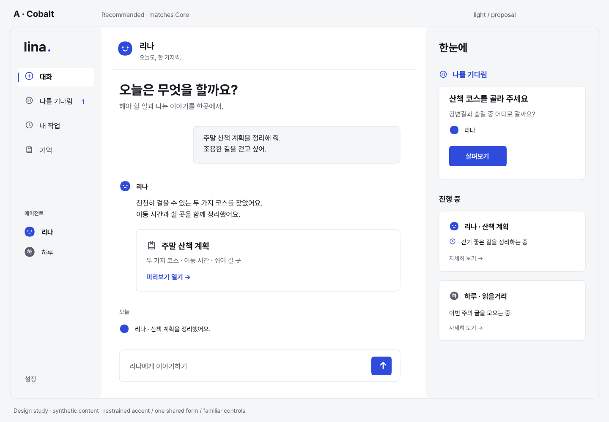
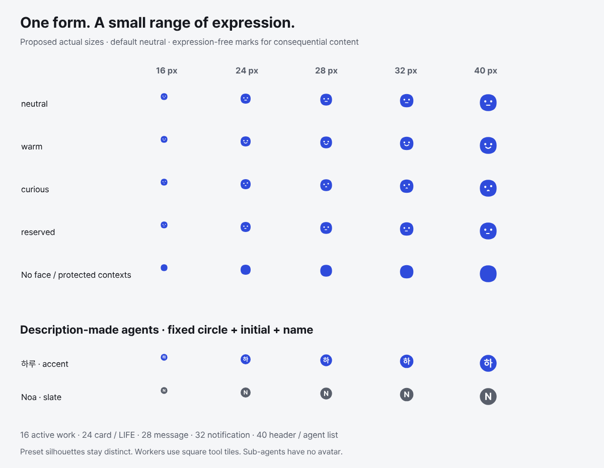
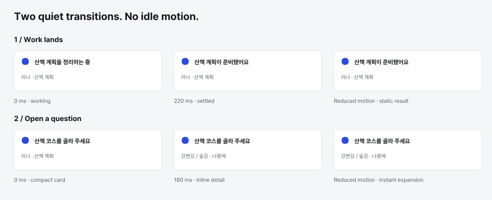
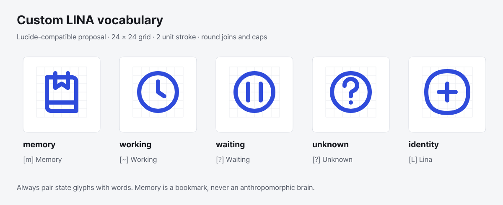
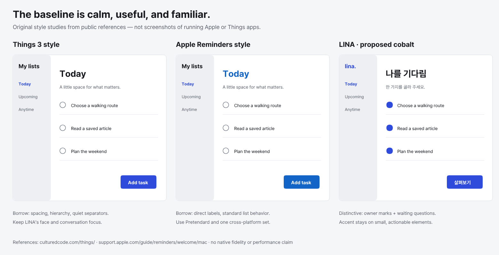

# Accent, agent form, interactions and icon study

Status: **proposal for owner decision [#4](https://github.com/lina-system/lina-app/issues/4)**.
This research addresses [#90](https://github.com/lina-system/lina-app/issues/90).
No choice is installed into `DESIGN.md` or the production token source.

## Recommendation and alternatives

Recommend **A, cobalt**, the fixed pebble form below, **Lucide**, and the two
restrained transitions below. Cobalt already appears in the Core design
contract, so it makes the app recognizable alongside the terminal without
introducing another brand color. All three candidates pass the requested
contrast thresholds; the recommendation is a design judgment, not a user-study
result. Teal is a quieter alternative but can resemble a success state. Iris
is more expressive but is closer to familiar AI-product branding. Neither hue
may carry success, failure, approval or agent identity on its own.

| Option | Light / dark / high contrast | Minimum accent/surface | Minimum text/accent | Captures |
| --- | --- | ---: | ---: | --- |
| **A · Cobalt (recommended)** | `#2F4BDB` / `#5685FF` / `#6795FF` | 4.753:1 | 5.813:1 | [Light](../../captures/90/a-cobalt-light.png) · [Dark](../../captures/90/a-cobalt-dark.png) · [HC](../../captures/90/a-cobalt-high-contrast.png) |
| B · Teal | `#006E73` / `#47B8BC` / `#61D9D9` | 5.584:1 | 6.038:1 | [Light](../../captures/90/b-teal-light.png) · [Dark](../../captures/90/b-teal-dark.png) · [HC](../../captures/90/b-teal-high-contrast.png) |
| C · Iris | `#6742C9` / `#B196FF` / `#C2ADFF` | 6.070:1 | 6.564:1 | [Light](../../captures/90/c-iris-light.png) · [Dark](../../captures/90/c-iris-dark.png) · [HC](../../captures/90/c-iris-high-contrast.png) |



The nine 1440 × 1000 PNGs use identical synthetic Korean content and layout.
Each contains a conversation, work cards, “나를 기다림”, preset and description-made
agent marks. Only the candidate and theme change. The [SVG sources](renders/)
remain editable; these are rendered mockups, not Flutter runtime captures.

## Contrast evidence and limits

[Full measured table](contrast.md) · [Unrounded measurements](contrast.json) ·
[Research-only input values](study.json).

Calculations follow [WCAG 2.2 relative luminance](https://www.w3.org/TR/WCAG22/#dfn-relative-luminance):
decode sRGB with the 0.04045 breakpoint, weight linear RGB by
0.2126/0.7152/0.0722, and divide `(Llighter + 0.05) / (Ldarker + 0.05)`.
The tests compare unrounded ratios; the table displays three decimals. The
`#777777`/white reference fails 4.5:1 even though rounding to one decimal says 4.5.

| Theme | Canvas | Card / conversation | Text on accent |
| --- | --- | --- | --- |
| Light | `#F5F6F8` | `#FFFFFF` | `#FFFFFF` |
| Dark | `#15171C` | `#1E2128` | `#080B10` |
| High contrast | `#000000` | `#0C0E12` | `#000000` |

Every accent is tested against **both** adjacent surfaces (at least 3:1), and
every button/face foreground against its opaque accent (at least 4.5:1).
Small accent-colored labels in light/dark also pass 4.5:1. In HC, cobalt on the
card is 6.733:1: adequate for AA but below the stronger 7:1 text aim. Therefore
HC labels use white, with cobalt reserved for adjacent glyphs/marks. Pure black
on HC cobalt is 7.320:1. Primary, secondary and on-accent text in HC all exceed
7:1. Slate identity initials use the canvas color on the secondary-text color;
those pairs are tested too. No translucent accent is part of this proposal.

Hairlines separate decorative layers, not the sole boundary of an unlabeled
control. Buttons have explicit action labels; states have words plus glyphs.
High contrast increases border weight and luminance. Production focus rings,
hover/pressed/disabled states, accessibility semantics, text scaling, keyboard
navigation, native rendering and color-vision user trials are not measured by
these static studies. Passing these pairs is not a full WCAG conformance claim.

## LINA and description-made agent marks



LINA is one compact, rounded pebble, with two eyes and a small mouth. Its outline
never changes, grows limbs, becomes a tool logo or morphs with work status.
The expression set is neutral (default), warm, curious and reserved. These are
visual alternatives for Core-provided expression, not local inferences about
the person. Expression does not communicate certainty or task success.

| Place named in #4 | Proposed logical size | Expression / motion |
| --- | ---: | --- |
| Conversation header | 40 px | Neutral by default; expression may crossfade once when Core state changes |
| Beside agent message | 28 px | Static expression snapshot for that message; no replay during scrolling |
| Active work indicator | 16 px | Static neutral; work state is the adjacent text, no pulse or spinning face |
| LIFE feed author | 24 px | Static; expression-free on a result/evidence entry |
| Notification | 32 px | Static; neutral, or expression-free for protected content |
| Card owner | 24 px | Static; expression-free for approval, evidence, result, failure or unknown |
| Agent list | 40 px | Static neutral with the full name |

#4 lists places rather than numeric sizes. These five sizes are proposals,
rendered at 1× above and individually as [SVG assets](marks/): all five sizes
have all four expressions plus an expression-free mark; both Korean and Latin
initial marks are drawn at all five sizes. Scale by device pixel ratio without
changing the logical size. The 16 px face is decorative; its adjacent name and
state must remain readable independently. Native optical checks remain future
implementation validation, not evidence of this study.

The rules have this precedence:

1. Approvals, evidence, results, failures and “모름” have **no face/expression**:
   only the unchanged silhouette and agent name. A neutral face is not used to
   soften or endorse a consequential decision.
2. Expression off, or Core-sensitive content: neutral face with no face motion.
3. Farewell: neutral or warm only (the mock selector uses warm).
4. Ordinary conversation: the bounded expression supplied by Core; no idle blink,
   breathing, bouncing, confetti or automatic emotional reaction to a button.

Each other preset must have its own fixed form and expression set, drawn under
the same size/contrast constraints; those seven preset designs are outside #90.
Description-made agents use **one common circle**, a single name initial and the
full name. The Korean example uses the first complete Hangul syllable (“하”);
Latin uses the first letter (“N”). Implementation must use a full grapheme,
uppercase where appropriate, and a neutral dot if no usable initial exists.
Names, including a short disambiguating label when initials collide, carry the
identity; neither color nor initials are unique identifiers.

Allow the selected accent and neutral slate (`secondary` in each theme) only,
with their tested on-color text. The examples show both. Users may choose their
name and one of those colors, but cannot upload an arbitrary shape, borrow a
preset silhouette, add status badges or choose an untested color. This keeps
one brand accent while providing a bounded color difference. Never truncate a
Korean grapheme or replace a multi-person name label with color alone.

Workers use square tool tiles; unknown tools get a generic tool glyph, never an
initial. Sub-agents have no avatar and appear as a line under the owner. Cards
and notifications show the persona name first. These are identity rules only;
this research implements no Core protocol or terminal palette changes.

## Two signature interactions



| Interaction | Trigger and normal presentation | Reduced motion and interruption |
| --- | --- | --- |
| Work lands quietly | A confirmed Core result updates the existing work row. Its status glyph settles vertically by 4 px over 220 ms, using a critically damped spring with no overshoot. The owner silhouette stays fixed; the result carries no expression. | Replace the status and content instantly. Keep the same announcement and result link. Never scroll, move focus, steal typing, replay after reconnect or animate old results. |
| A waiting question opens in place | An explicit click/key activation expands that card's details over 180 ms with ease-out, keeping its heading anchored. The action does not imply approval. | Expand instantly at the same anchor. Escape/collapse returns focus to the opener; a second action cancels the transition. Preserve draft input. |

Expression crossfades use the ordinary platform fade, at most 120 ms after a
confirmed change; reduced motion or expression-off makes them static. This is
not a third signature interaction. All selection, scrolling, editing, menus,
dialogs and navigation use familiar platform behavior. These timings are
proposals and storyboards, not measured frame-time or assistive-tech results.

## Icon decision

Recommend **Lucide**, retaining its 24-unit grid and 2-unit round stroke. At the
20/24 px sizes used here, its geometry is easy to share with the original LINA
drawings. Neither set has a product-specific memory or persona identity rule;
neither eliminates the custom work below. SF Symbols are excluded because their
license does not cover LINA's non-Apple platforms.

| Criterion | Lucide | Phosphor |
| --- | --- | --- |
| License / platforms | ISC, with MIT notices for Feather-derived icons; cross-platform use allowed with notices | MIT; cross-platform use allowed with notices |
| Grid and weight | `viewBox 0 0 24 24`, stroke 2, round caps/joins | `viewBox 0 0 256 256`; regular exported as filled outlines (chat ring thickness 16 units = 1.5 at 24 px); thin/light/regular/bold/fill/duotone families |
| Coverage sampled below | All 12 required generic roles present | All 12 required generic roles present |
| Flutter integration | Export vetted SVGs or adopt an audited binding later; no runtime dependency selected here | Upstream lists a Flutter binding; likewise requires dependency/notice review at implementation |
| Tradeoff | Single outline vocabulary fits restrained interface; preferred | More weight choices, but mixing weights would weaken consistency; viable alternative |

Asset names checked against the pinned upstream trees, not inferred from names:

| Role | Lucide asset | Phosphor regular asset | TUI Unicode / ASCII fallback (always with label) |
| --- | --- | --- | --- |
| Conversation | `message-circle` | `chat-circle` | `›` / `>` Conversation |
| Work list | `list-todo` | `list-checks` | `≡` / `[w]` Work |
| Question | `circle-question-mark` | `question` | `?` / `?` Question |
| Search | `search` | `magnifying-glass` | `/` / `/` Search |
| Settings | `settings` | `gear` | `⚙` / `[s]` Settings |
| Calendar | `calendar-days` | `calendar-dots` | `□` / `[d]` Calendar |
| Library | `book-open` | `book-open` | `▤` / `[b]` Library |
| Notifications | `bell` | `bell` | `•` / `[n]` Notifications |
| Completed | `check` | `check` | `✓` / `[x]` Done |
| Failure | `circle-alert` | `warning-circle` | `!` / `!` Failed |
| External link | `external-link` | `arrow-square-out` | `↗` / `->` Open |
| Attachment | `paperclip` | `paperclip` | `+` / `[a]` Attachment |



Original [SVGs](icons/) use the same 24 × 24 grid, 2-unit stroke, round caps and
joins; scale uniformly, without mixing filled Phosphor icons into the set.
Memory is a bookmark in a record, working is a clock, waiting is a pause,
unknown is a question mark, and the identity picker is a pebble with a plus.
The actual identity mark is the preset/initial asset, not the picker glyph.
TUI equivalents are `[m] Memory`, `[~] Working`, `[?] Waiting`, `[?] Unknown`
and `[L] Lina` (or the full agent name). “Waiting” and “Unknown” require their
different words; a glyph alone would be ambiguous. The TUI must fall back to
ASCII when width support is unknown; no emoji-width dependency. Implementing
these mappings in Core is outside this app research; the owner-selected mapping
can be handed to Core after #4.

## Baseline comparison



This PNG is an **original reconstruction of the style baseline**, based on the
public [Things page](https://culturedcode.com/things/) and
[Apple Reminders guide](https://support.apple.com/guide/reminders/welcome/mac).
It is not a native screenshot or a claim of pixel parity. It compares generous
spacing, firm sans-serif headings, neutral surfaces, quiet separators, bounded
accent and familiar list behavior. LINA adds conversation-first organization,
named agent marks and waiting questions. It avoids cream surfaces, serif titles,
terracotta, large colored panels and ornamental gradients. The rendered corners
use cubic transitions toward flat sides rather than circular corner arcs;
production curvature will need native optical validation.

All panels use bundled Pretendard and synthetic text. No Apple/Things artwork,
font, screenshot or implementation code is redistributed. A capture from the
running reference apps cannot be made on this Linux host: **unverified**, tracked
as the sole remaining native-baseline item in
[#92](https://github.com/lina-system/lina-app/issues/92), in the same milestone.

## Owner choice and scope

The owner chooses A/B/C (or requests revision), the pebble/expression bounds,
the identity restrictions, Lucide versus Phosphor, and the two motion proposals.
The baseline follow-up informs that choice. #4 remains open; only after the
owner's decision should #5's token work adopt values and generate `DESIGN.md`.
Core already specifies cobalt while #4 remains open; this proposal preserves
that continuity without treating it as permission to close the owner's decision.

No Flutter framework decision, app behavior, Core schema, TUI Lip Gloss palette,
production theme or token source changes here. The Flutter pin is unchanged.
Claude Design/Stitch were not used; #90's deliverables are reproducible SVG/PNG
studies. Real-device motion, optical size, native accessibility and performance
are unverified implementation acceptance, not completed checks in this research.

## Reproduce and verify

From the repository root, with Node 24:

```sh
npm ci --prefix scripts/design-study --ignore-scripts
node --test scripts/design-study/study.test.mjs
npm run render --prefix scripts/design-study
npm run check --prefix scripts/design-study
```

The renderer uses the pinned MIT-licensed `@napi-rs/canvas@0.1.100`, clears the
font registry, loads only the two bundled Pretendard faces, outlines text for
rasterization, and writes 13 PNGs plus SVG sources and numerical evidence.
The byte-for-byte drift check also checks the standalone mark/icon SVGs and
evidence. CI runs the focused tests and regeneration check on Linux; no network
or installed font is needed after `npm ci`. SVG text uses the bundled font
when rendered by the script; an arbitrary SVG viewer must install Pretendard.
The PNGs are the portable visual evidence. This is tooling for research only.

Tests verify reference luminance pairs, all nine color/theme combinations,
slate identity contrast, expression suppression precedence and the unchanged
LINA silhouette at every proposed size. The initial red run failed with
`ERR_MODULE_NOT_FOUND` before the generator existed; the implemented suite
passes. See [manifest](manifest.json) for generated outputs and
[third-party notices](THIRD-PARTY-NOTICES.md) for font provenance.

## Sources

- Core [visual language, icons and agent presentation](https://github.com/lina-system/lina/blob/eae8a6796b013d0b3e859465de8b0da955ddecaf/docs/design/surfaces.md#one-design-language),
  [deferred choices](https://github.com/lina-system/lina/blob/eae8a6796b013d0b3e859465de8b0da955ddecaf/docs/design/surfaces.md#deferred),
  and [emotion](https://github.com/lina-system/lina/blob/eae8a6796b013d0b3e859465de8b0da955ddecaf/docs/design/conversation-and-memory.md#emotion), read 2026-10-24.
- [Lucide license](https://github.com/lucide-icons/lucide/blob/7faf87628a1ad6175975bc595344337ce14a7db4/LICENSE)
  and [SVG assets](https://github.com/lucide-icons/lucide/tree/7faf87628a1ad6175975bc595344337ce14a7db4/icons).
- [Phosphor license](https://github.com/phosphor-icons/core/blob/2b75f3ad12b420c9504ef05df8d2564a28f8500e/LICENSE)
  and [regular assets](https://github.com/phosphor-icons/core/tree/2b75f3ad12b420c9504ef05df8d2564a28f8500e/assets/regular).
- [WCAG 2.2 contrast minimum](https://www.w3.org/TR/WCAG22/#contrast-minimum)
  and [non-text contrast](https://www.w3.org/TR/WCAG22/#non-text-contrast).
