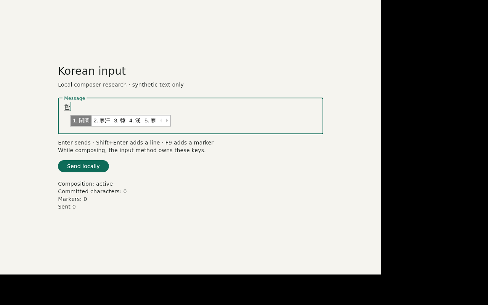

# Korean input: Flutter 3.47.8 research

Research for [#88](https://github.com/lina-system/lina-app/issues/88) and the
owner decision [#1](https://github.com/lina-system/lina-app/issues/1).
Checked **2026-10-24**. The owner closes #1 after the physical-device gate.

## Scope and design sources

The native-only [spike](../../spikes/korean-input/) contains one multiline
composer, Enter submission, Shift+Enter newline and one F9 shortcut. It has
standard Flutter 3.47.8 runners for Linux, macOS, Windows, iOS and Android.
Only Linux is built and exercised here. Generated runners are not device-build
or platform acceptance evidence. There is no web target and no Core connection.

The source requirements are the five Korean input criteria in #1, and Core's
[Korean input](https://github.com/lina-system/lina/blob/eae8a6796b013d0b3e859465de8b0da955ddecaf/docs/design/surfaces.md#korean-input),
[Platform adaptation](https://github.com/lina-system/lina/blob/eae8a6796b013d0b3e859465de8b0da955ddecaf/docs/design/surfaces.md#platform-adaptation),
[No web feel](https://github.com/lina-system/lina/blob/eae8a6796b013d0b3e859465de8b0da955ddecaf/docs/design/surfaces.md#no-web-feel),
and [LINA OS composition](https://github.com/lina-system/lina/blob/eae8a6796b013d0b3e859465de8b0da955ddecaf/docs/design/runtime.md#lina-os-composition).
The latter delegates the input setup to
[LINA OS design](https://github.com/lina-system/lina-os/blob/ff0926dd4824f492b7985babfad3a340de41ceaf/docs/design.md),
which adds fcitx5-hangul and requires the app's GTK input-method environment.

**Design mismatch:** the current Core documents specify Wails/WebViews, whereas
#88 and this repository explicitly request a Flutter decision experiment.
This PR follows #88 without changing Core's shell decision. The owner must
reconcile the design text when deciding #1. DOM-specific rules in Core are
translated into Flutter's composing-range and key-event rules below; they are
not implemented as a custom IME bridge.

## Composer contract used by this experiment

- `TextField`, `TextEditingController` and the standard platform text-input
  connection own the draft. No input formatter, length limit, normalization,
  trim, or controller write runs during a nonempty composing range.
- The field is multiline, with `TextInputAction.newline`. Mobile soft return
  remains a newline; the local send button is available. A platform `send`
  action, if supplied, uses the same gate as the button and desktop Enter.
- A nonempty valid composing range blocks application Enter and F9 handling.
  The guard remains set until the end of the frame after composition ends,
  covering a commit and redispatched key in the same turn. Such keys are
  returned unhandled to the standard IME path. No delayed send is queued.
  The default editing-completion callback is disabled so it cannot clear the
  composing range or move focus before this gate runs.
- Unmodified Enter or keypad Enter sends only a committed, nonempty draft.
  Key repeats cannot submit again. Shift+Enter replaces the selection with a
  newline only outside composition, preserving multiline selection behavior.
  F9 increments a marker outside composition; it is deliberately also the
  fcitx5-hangul Hanja key, so candidate-key leakage can be observed.
- A send first copies the exact text to the synchronous, in-memory receipt and
  increments the count; only then is the controller cleared. No actual message
  goes to Core. A production asynchronous send needs an acknowledged request
  identity and must not erase edits typed after that request. Local counts
  alone do **not** prove Core ledger exactly-once delivery.
- `enableSuggestions: true` and `autocorrect: true` are explicit. In particular,
  suggestions must not be disabled to work around composition: Gboard can hide
  Korean when they are disabled (#139143). iOS ties suggestions to autocorrect.
- Character counts use extended grapheme clusters (`text.characters.length`),
  read from controller notifications only when composition is inactive.
  During composition the UI retains its last committed count. Counts never
  alter the text. Diagnostics read composing ranges without writing them.
- The optional `IME_TRACE` build flag prints synthetic draft/selection/preedit
  and local receipt events. It is off by default. There is no telemetry,
  persistence, model, external service, or non-SDK runtime plugin.

A first Enter that the IME consumes to commit or select a candidate is not an
application send. Record that separately from the stricter #1 requirement of
sending with a single Enter during composition; never call a two-Enter flow a
single-Enter pass.

## Evidence and result definitions

C1 = inline preedit **and** candidate window at the caret. C2 = no dropped
syllables at the measured typing rates. C3 = full draft sent exactly once by
one Enter during composition. C4 = IME-consumed keys trigger neither send nor
shortcut. C5 = Backspace, arrows and focus behavior match a native field.

`Pass (host)` is bounded to the recorded Linux X11/Xvfb experiment; it is not a
physical-device acceptance pass. `Fail (host)` records the observed failure,
not an inferred defect in Flutter alone. `Unverified` means the named
configuration has not been run. No physical-platform row is accepted here.

## Results

| Platform / IME | C1 | C2 | C3 | C4 | C5 | Physical acceptance |
| --- | --- | --- | --- | --- | --- | --- |
| Linux X11/Xvfb, fcitx5-hangul 2-set, Flutter | Pass (host) | **Fail (host)** | **Fail (host)** | Pass (host) | Pass (host, bounded) | **Unverified**; this is a virtual display |
| Windows, Microsoft IME 2-set | Unverified | Unverified | Unverified | Unverified | Unverified | Unverified |
| Windows, Microsoft IME 3-set | Unverified | Unverified | Unverified | Unverified | Unverified | Unverified |
| Omarchy 4 / native Wayland, fcitx5-hangul | Unverified | Unverified | Unverified | Unverified | Unverified | Unverified |
| macOS, system Korean 2-set | Unverified | Unverified | Unverified | Unverified | Unverified | Unverified; Mac host unreachable, Xcode not checked |
| iOS, system Korean | Unverified | Unverified | Unverified | Unverified | Unverified | Unverified |
| Android, Gboard Korean | Unverified | Unverified | Unverified | Unverified | Unverified | Unverified |
| Android, Samsung Keyboard Korean | Unverified | Unverified | Unverified | Unverified | Unverified | Unverified |

### Linux observations

Run date: 2026-10-24. Ubuntu 26.04.1 x86_64, GTK 3.24.52,
fcitx5 5.1.19, fcitx5-hangul 5.1.9, GTK frontend 5.1.6, libhangul 0.2.0.
Flutter 3.47.8 framework `737ba8f885`, engine `cf636b1dfb`, Dart 3.13.7;
debug Linux build, software rendering, Xvfb 1280×800 and a 1000×720 window.
The app source SHA-256 and binary SHA-256 are in
[environment.json](captures/korean-input/environment.json).
The composer source is unchanged from app commit `13e658bb6c37979bd12edb0ee374cb4507e7dabc`;
the recorder's physical-F9/configuration corrections are included in this PR.

The private fcitx configuration used `Keyboard=Dubeolsik`, `HanjaMode=False`,
`HanjaModeToggleKey=F9`, a US keyboard group plus Hangul, and
`GTK_IM_MODULE=fcitx`. Key events went through XTest → X11 → fcitx5 → GTK IM
→ Flutter's platform input connection. No precomposed Hangul was injected.
The same key sequences ran against a native GTK3 TextView in that session.

- **C1, pass in this host configuration:** `한` remains inline and underlined
  at the caret. The Hanja popup adjoins that caret on the first line and follows
  it onto the second line. See [first line](captures/korean-input/flutter-02-candidates.png)
  and [second line](captures/korean-input/flutter-17-candidates-second-line.png).
  Other display scales, window moves, IMEs and native Wayland are unverified.
- **C2, fail:** at 0 ms and 1 ms requested inter-key delay, Flutter matched
  `동해물과 백두산이` in **0/5 trials at each delay**, both before and after an
  explicit Right-arrow commit. Typical preedit result: `동해물과백두산 `;
  after commit: `동해물과백두산 이`. The space moved and the final syllable
  was invisible until commit. At 12 ms, this run matched 5/5. The initial run
  matched only 3/5 at 12 ms, so that rate is not a reliable pass either.
- **C3, fail:** the isolated slow-input case (80 ms requested delay) first
  produced the exact phrase with final `이` composing. One Enter appended a
  newline and produced **zero new receipts**. A second Enter sent
  `동해물과 백두산이\n` once. See [before Enter](captures/korean-input/flutter-14-slow-preedit.png),
  [first Enter](captures/korean-input/flutter-15-slow-first-enter.png), and
  [second Enter](captures/korean-input/flutter-16-slow-second-enter.png).
  Fast input sometimes sent on the first Enter, but with the displaced space;
  that does not pass. The composition guard prevents a premature send but
  leaves multiline editing to the platform; it does not meet the strict
  single-Enter requirement. This is a measured limit of this implementation,
  not proof that every possible Flutter composer must fail.
- **C4, pass for the tested keys:** real F9 opened the candidate popup, and
  candidate-confirmation Enter changed neither the marker count nor send
  count. With the IME inactive and the draft committed, F9 incremented the
  marker from 0 to 1. The popup's first suggested word differed between
  Flutter (`閑閑`) and GTK (`韓`); selecting the displayed multi-character word
  is not evidence of a duplicated send. Candidate contents deserve a separate
  physical check even though placement and key ownership passed here.
- **C5, pass for the recorded operations:** Backspace changed composing `한`
  to `하`; Left committed and moved before it; typing `가` gave `가하`.
  Focus-away committed `한`; returning and typing `글` gave `한글` without
  loss or duplication. The native GTK reference produced equivalent text and
  caret behavior. Shift+Enter after commit gave `한\n` in both controls.
  Flutter Tab and GTK Ctrl+Tab move to the button (GTK Tab normally inserts a
  tab). Cross-client/two-field leakage, other navigation keys and physical
  focus/window-manager behavior are unverified.

| Requested XTest delay | Flutter exact text, before / after commit | Native GTK exact text, before / after commit |
| --- | --- | --- |
| 0 ms | 0/5 / 0/5 | 2/5 / 2/5 |
| 1 ms | 0/5 / 0/5 | 5/5 / 5/5 |
| 12 ms | 5/5 / 5/5 | 5/5 / 5/5 |

The 0 ms native failures matter: native GTK alone is **not a demonstrated
universal cure**. These are requested injection delays, not measured physical
keystroke speeds or a production benchmark. The root cause across XTest,
fcitx/GTK, Flutter event ordering and the app has not been established. The
1 ms difference is evidence to investigate, not grounds to attribute every
failure solely to Flutter.

The first recorder run requested F9 through xdotool, whose keysym mapping
actually generated **Alt+F9** on this Xvfb map. That invalidated its C1/C4
observations. The corrected recorder injects physical F9 through XTest;
[fcitx key events](captures/korean-input/fcitx-keys.txt) confirm `F9 states=0`
and consumed candidate keys. The correction was rerun against both controls.
Only the initial run's valid speed observations are retained separately.

Evidence: [all scenario snapshots](captures/korean-input/observations.json),
[Flutter event trace](captures/korean-input/flutter-events.json),
[GTK event trace](captures/korean-input/gtk-events.json),
[initial speed trials](captures/korean-input/initial-speed-observations.json),
and [sampled screen recording](captures/korean-input/linux-x11.gif).
The GIF samples the actual display approximately twice per second; it is not
a latency measurement. The JSON traces retain the finer event sequence.

### Recommendation and native-input boundary

**Do not approve Flutter input everywhere. Recommend a native-input fallback
for Linux desktop as the next implementation candidate**, with the final
choice gated by the physical Omarchy/Wayland comparison in #95. Keep Windows,
macOS, iOS and Android undecided until their actual IMEs run. Do not treat the
native GTK reference as an already accepted replacement: it needs the same
five criteria, including send handling and the fastest-input case.

If the Linux failures reproduce on the shipping session, replace the editing
control first: the multiline composer, and the same adapter for intent/memo,
search/launcher and document-editing fields that share the failing input path.
The native control owns text, selection, preedit, surrounding text, candidate
placement, focus, keyboard layout and consumed-key decisions. Flutter owns
layout, labels, buttons, receipts and the shared design tokens. Exchange
committed drafts and explicit submit requests with stable IDs; never mirror
preedit back into the native control. Clear only the acknowledged draft, and
verify one Core ledger message per submission in the production integration.
Do not replace unrelated app surfaces based on this input-only experiment.

The owner must decide whether to pursue that boundary or a demonstrated
composer/engine correction, then reconcile Core's current Wails design. A
widget-test pass cannot settle that decision, and neither #1 nor any physical
platform gate is closed by this research.

## Upstream status on the evaluated version

Checked 2026-10-24 through the GitHub issue API; the
[status snapshot](captures/korean-input/upstream-2026-10-24.json) is committed.
An open report is a risk, not proof of reproduction on 3.47.8. Closure alone is
not proof of a runtime fix in that version.

| Flutter issue | Status checked | What it establishes for Flutter 3.47.8 |
| --- | --- | --- |
| [#189491](https://github.com/flutter/flutter/issues/189491), Windows fast Hangul loss | Open; updated 2026-08-06 | Not retested: MS IME 2/3-set physical Windows runs remain required. |
| [#91798](https://github.com/flutter/flutter/issues/91798), Linux iBus/fcitx text input | Open; updated 2024-06-27 | Only the exact fcitx5-hangul X11 configuration below is exercised; this does not close the broader report or verify Wayland/iBus. |
| [#126329](https://github.com/flutter/flutter/issues/126329), fcitx candidate placement | Open; updated 2024-06-07 | Inspect the committed Hanja popup capture; Sogou and other fcitx engines are not tested. Native Wayland remains unverified. |
| [#191196](https://github.com/flutter/flutter/issues/191196), Windows focus composition leak | Open; updated 2026-09-17 | Windows not available. Linux focus results cannot establish a Windows fix. |
| [#140537](https://github.com/flutter/flutter/issues/140537), Windows 3-set spaces | Open; updated 2025-03-18 | No Windows 3-set result; test literal spaces on that layout. |
| [#139143](https://github.com/flutter/flutter/issues/139143), Gboard Korean with suggestions disabled | Closed as completed 2026-10-02 | [#192714](https://github.com/flutter/flutter/pull/192714) documents the restriction; it is not a runtime fix. This spike uses suggestions=true. Gboard device behavior is still unverified. |

## Physical-device handover protocol

These are **unrun instructions**, not evidence. Admission reason: external
physical devices and native sessions unavailable to this run. Each run must
record the app commit, Flutter framework/engine revision, device model, OS,
IME version, keyboard layout, suggestion/autocorrect settings, display scale,
and a screen recording with synthetic text. Record the exact build/run command,
exit status and observed result for each criterion; an unavailable build or
screen recording remains unverified.

1. Build this spike on the target with Flutter 3.47.8. Use `flutter run -d
   <device-id> --dart-define=IME_TRACE=true` and retain the trace with the capture.
   Use only synthetic text because the trace contains the draft. Reproduce
   every failing operation in a native multiline text field on the same device.
2. C1: type `한` without committing it, open the platform's Hanja/candidate UI,
   and move the caret to another line and a distant horizontal position before
   repeating. Expect inline preedit and a popup adjoining the current caret,
   not the field origin, another window, or the screen corner. Test display
   scaling and moving the window as well. On a mobile keyboard without a popup,
   record its actual candidate behavior rather than inventing a pass.
3. C2: type `동해물과 백두산이` slowly, at normal speed, and as fast as possible,
   at least ten repetitions at each speed. Record the exact resulting text and
   compare every syllable and space. On Windows repeat with MS IME 2-set and
   3-set; specifically exercise spaces and fast rollover. A matching final
   screenshot from one run is not evidence that every trial matched.
4. C3: leave the final syllable in preedit, press Enter **once**, then inspect
   the receipt count and text. Expect one exact receipt, no duplicated final
   syllable and no stale text after the accepted send. Record a commit-only
   Enter as such. Also hold Enter and verify it does not send repeated drafts.
   Candidate-confirmation Enter must not send. Production acceptance additionally
   needs one Core ledger message per acknowledged send.
5. C4: open candidates using F9 on fcitx5-hangul (use the platform candidate key
   elsewhere), select/navigate/confirm candidates, and check that marker and
   send counts stay unchanged. With the field committed and candidates closed,
   F9 must increment exactly once. Test input-mode switching and modifier keys.
6. C5: type `한`, Backspace once, Left, and then `가`; compare the resulting text,
   selection and preedit with the native control. Repeat with Right, Home/End
   and selection replacement. Move focus to the button and back during preedit,
   then type `글`; check for leaks, dropped text or duplicated syllables. Test
   another window and another field in a separate harness for client-change
   leakage (this intentionally single-field spike cannot establish that case).
7. Test Enter, Shift+Enter and the send button with a selection, multiple lines,
   a blank draft and an emoji grapheme cluster. On mobile run both the software
   keyboard and an attached hardware keyboard where available; note any missing
   hardware-keyboard test separately.

For Omarchy 4, use LINA OS's installed fcitx5-hangul configuration on native
Wayland, capture the actual Hyprland/fcitx5/libhangul versions and input-method
environment, and repeat after restarting fcitx5 and with Qt applications open.
Do not force text-input-v1 or treat this X11 experiment as equivalent. The
published design specifies the package and environment but not every Hangul
configuration key; attach the effective configuration to the physical run.

## Remaining work

[App #95](https://github.com/lina-system/lina-app/issues/95), in the same
milestone as #88, tracks exactly the unavailable physical-device builds and
runs: Windows MS IME 2/3-set, Omarchy 4 fcitx5-hangul/native Wayland, macOS
system 2-set, iOS system Korean, Android Gboard and Samsung Keyboard. The Mac
host's DNS lookup failed during the SSH/Xcode probe; neither Xcode availability
nor a macOS input result was established.

[Core #1633](https://github.com/lina-system/lina/issues/1633) tracks the
authoritative Platform adaptation/Korean input design update after the owner
reconciles #1 with the current Wails design. Core schema and TUI palette changes
are outside this app research. The production Core-ledger exactly-once check
also remains an integration requirement, not a claim made by this local spike.
